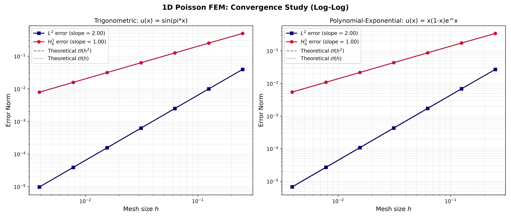
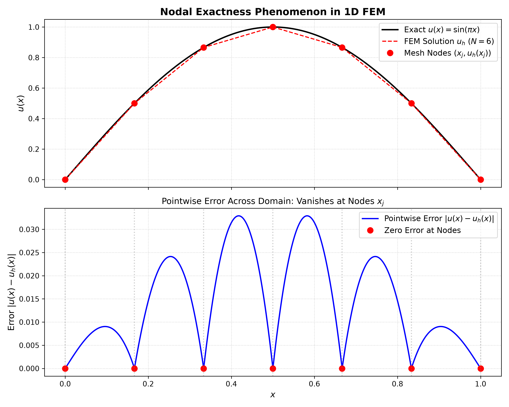
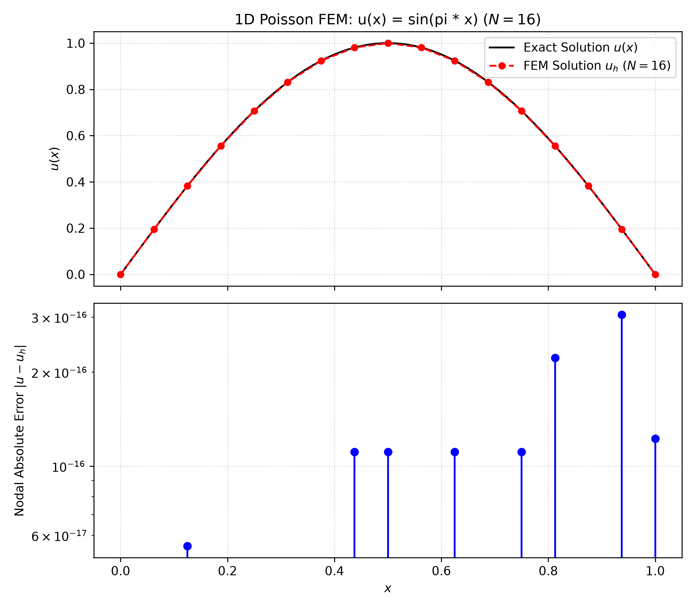
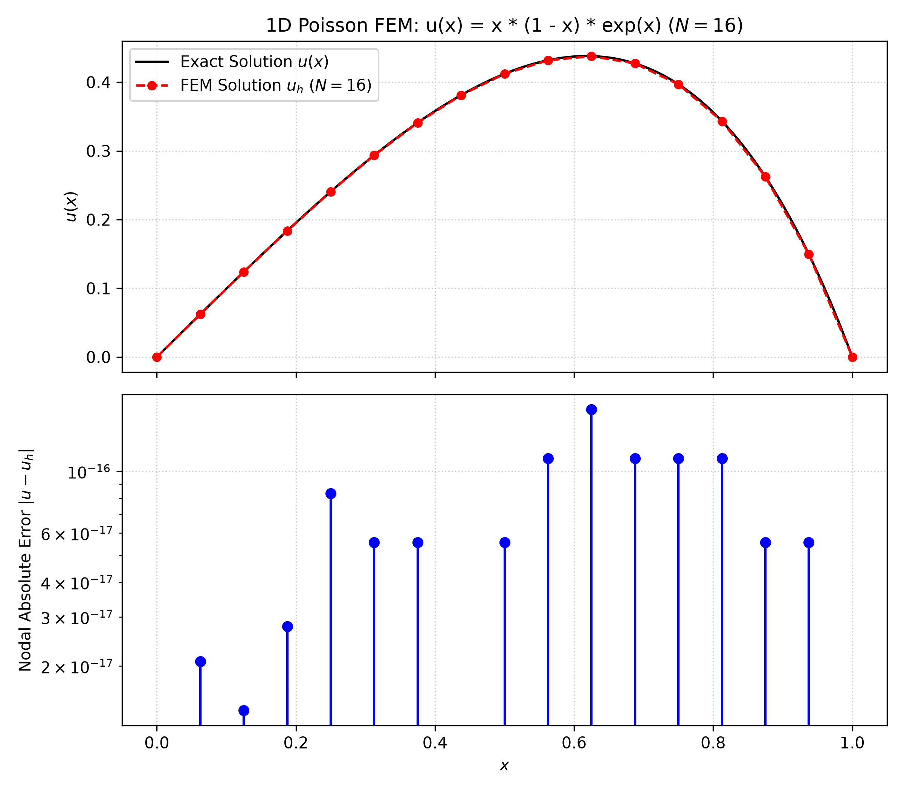

# FEM1D Part A — One-Dimensional Finite Element Method

## 1. Project Overview

This project implements a modular one-dimensional Finite Element Method (FEM) solver for the Poisson boundary value problem on the unit interval $[0,1]$, subject to homogeneous Dirichlet boundary conditions.

The solver uses continuous, piecewise linear finite elements to approximate the solution. Manufactured benchmark problems with known analytical solutions are used to evaluate numerical accuracy, investigate convergence behavior, and verify nodal exactness.

## 2. Project Features

- One-dimensional mesh generation.
- Linear Lagrange basis functions.
- Gauss–Legendre numerical quadrature.
- Element stiffness matrix and load vector assembly.
- Homogeneous Dirichlet boundary condition handling.
- Direct solution of the resulting linear system.
- Calculation of $L^2$, $H^1$-seminorm, and maximum nodal errors.
- Convergence studies with numerical tables and log–log plots.
- Nodal exactness verification.
- Automated tests for core numerical components.
- Generation of solution, convergence, and nodal error figures.

## 3. Mathematical Formulation

The solver considers the one-dimensional Poisson equation

$$
-u''(x)=f(x), \qquad x\in(0,1),
$$

with homogeneous Dirichlet boundary conditions

$$
u(0)=u(1)=0.
$$

The weak formulation is to find $u\in H_0^1(0,1)$ such that

$$
a(u,v)=\ell(v)
\qquad \forall v\in H_0^1(0,1),
$$

where the bilinear form and linear functional are defined by

$$
a(u,v)=\int_0^1 u'(x)v'(x)\,dx,
$$

$$
\ell(v)=\int_0^1 f(x)v(x)\,dx.
$$

The discrete solution is constructed using continuous, piecewise linear finite element basis functions on a partition of the interval.

## 4. Computational Workflow

The solver follows a modular computational pipeline:

1. **Mesh generation:** Partition the unit interval into finite elements.
2. **Basis functions:** Define local linear basis functions and their derivatives.
3. **Numerical quadrature:** Evaluate element load integrals using Gauss–Legendre quadrature.
4. **Assembly:** Construct the global stiffness matrix and load vector from element contributions.
5. **Boundary conditions:** Apply homogeneous Dirichlet boundary conditions.
6. **Linear solve:** Solve the reduced system for the interior degrees of freedom.
7. **Error calculation:** Evaluate numerical errors against the analytical solution.
8. **Verification:** Run convergence studies and nodal exactness checks.

## 5. Project Structure

```text
FEM1D_PartA/
├── src/
│   └── fem1d/
│       ├── __init__.py
│       ├── assembly.py
│       ├── basis.py
│       ├── boundary.py
│       ├── errors.py
│       ├── manufactured.py
│       ├── mesh.py
│       ├── quadrature.py
│       └── solver.py
├── tests/
│   ├── test_assembly.py
│   ├── test_convergence.py
│   ├── test_mesh.py
│   └── test_quadrature.py
├── scripts/
│   ├── run_simulation.py
│   ├── run_convergence.py
│   └── verify_nodal_exactness.py
├── output/
│   └── figures/
│       ├── convergence_study.png
│       ├── nodal_exactness.png
│       ├── solution_sin_N16.png
│       └── solution_poly_exp_N16.png
├── docs/
├── .gitignore
├── pyproject.toml
├── uv.lock
└── README.md
```

## 6. Requirements and Installation

### 6.1 Requirements

- Python 3.14, as used in the current development environment.
- `uv` for Python environment and dependency management.

Project dependencies are specified in `pyproject.toml` and `uv.lock`.

### 6.2 Installation

Open PowerShell in the project root directory and run:

```powershell
uv sync
```

This installs the project dependencies and synchronizes the environment with the project configuration.

## 7. Running the Project

Run all commands from the project root directory.

### 7.1 Trigonometric Benchmark

Solve the problem using the exact solution $u(x)=\sin(\pi x)$ with 16 elements.

```powershell
uv run python scripts/run_simulation.py --case sin -n 16
```

### 7.2 Polynomial-Exponential Benchmark

Solve the problem using the exact solution $u(x)=x(1-x)e^x$ with 16 elements.

```powershell
uv run python scripts/run_simulation.py --case poly_exp -n 16
```

### 7.3 Convergence Study

```powershell
uv run python scripts/run_convergence.py
```

This command prints convergence tables for the trigonometric and polynomial-exponential benchmarks and generates the convergence figure.

### 7.4 Nodal Exactness Verification

```powershell
uv run python scripts/verify_nodal_exactness.py
```

This command evaluates nodal errors for the benchmark problems and generates the nodal exactness figure.

### 7.5 Run the Test Suite

```powershell
uv run pytest
```

The latest reported test run completed successfully with 15 passing tests.

## 8. Manufactured Benchmark Solutions

The implementation includes three benchmark problems with known analytical solutions.

| Benchmark | Exact Solution $u(x)$ | Forcing Function $f(x)=-u''(x)$ |
| :--- | :---: | :---: |
| Trigonometric | $\sin(\pi x)$ | $\pi^2\sin(\pi x)$ |
| Polynomial-exponential | $x(1-x)e^x$ | $x(x+3)e^x$ |
| Quadratic | $x(1-x)$ | $2$ |

All three solutions satisfy the homogeneous boundary conditions $u(0)=u(1)=0$.

## 9. Results and Numerical Verification

The convergence study uses the element counts

$$
N\in{4,8,16,32,64,128,256},
$$

where $N$ is the number of elements and $h=1/N$ is the uniform mesh size.

For continuous, piecewise linear finite elements, the expected convergence rates are:

- $L^2$ error: $O(h^2)$.
- $H^1$-seminorm error: $O(h)$.

The convergence rate between successive meshes is calculated as

$$
p=\frac{\log(E_h/E_{h/2})}{\log(2)},
$$

where $E_h$ denotes the error for mesh size $h$.

### 9.1 Convergence Table: $u(x)=\sin(\pi x)$

| $N$ | Mesh Size $h$ | $L^2$ Error | Rate ($L^2$) | $H^1_0$ Semi-Norm Error | Rate ($H^1$) | Max Nodal Error |
| :---: | :---: | :---: | :---: | :---: | :---: | :---: |
| 4 | $2.500 \times 10^{-1}$ | $3.928 \times 10^{-2}$ | — | $4.985 \times 10^{-1}$ | — | $3.26 \times 10^{-13}$ |
| 8 | $1.250 \times 10^{-1}$ | $9.921 \times 10^{-3}$ | **1.99** | $2.512 \times 10^{-1}$ | **0.99** | $5.55 \times 10^{-16}$ |
| 16 | $6.250 \times 10^{-2}$ | $2.487 \times 10^{-3}$ | **2.00** | $1.258 \times 10^{-1}$ | **1.00** | $3.05 \times 10^{-16}$ |
| 32 | $3.125 \times 10^{-2}$ | $6.220 \times 10^{-4}$ | **2.00** | $6.295 \times 10^{-2}$ | **1.00** | $2.78 \times 10^{-15}$ |
| 64 | $1.562 \times 10^{-2}$ | $1.555 \times 10^{-4}$ | **2.00** | $3.148 \times 10^{-2}$ | **1.00** | $9.55 \times 10^{-15}$ |
| 128 | $7.812 \times 10^{-3}$ | $3.888 \times 10^{-5}$ | **2.00** | $1.574 \times 10^{-2}$ | **1.00** | $8.77 \times 10^{-15}$ |
| 256 | $3.906 \times 10^{-3}$ | $9.721 \times 10^{-6}$ | **2.00** | $7.870 \times 10^{-3}$ | **1.00** | $3.45 \times 10^{-14}$ |

### 9.2 Convergence Table: $u(x)=x(1-x)e^x$

| $N$ | Mesh Size $h$ | $L^2$ Error | Rate ($L^2$) | $H^1_0$ Semi-Norm Error | Rate ($H^1$) | Max Nodal Error |
| :---: | :---: | :---: | :---: | :---: | :---: | :---: |
| 4 | $2.500 \times 10^{-1}$ | $2.692 \times 10^{-2}$ | — | $3.416 \times 10^{-1}$ | — | $1.11 \times 10^{-16}$ |
| 8 | $1.250 \times 10^{-1}$ | $6.842 \times 10^{-3}$ | **1.98** | $1.732 \times 10^{-1}$ | **0.98** | $5.55 \times 10^{-17}$ |
| 16 | $6.250 \times 10^{-2}$ | $1.718 \times 10^{-3}$ | **1.99** | $8.692 \times 10^{-2}$ | **0.99** | $1.67 \times 10^{-16}$ |
| 32 | $3.125 \times 10^{-2}$ | $4.298 \times 10^{-4}$ | **2.00** | $4.350 \times 10^{-2}$ | **1.00** | $1.44 \times 10^{-15}$ |
| 64 | $1.562 \times 10^{-2}$ | $1.075 \times 10^{-4}$ | **2.00** | $2.175 \times 10^{-2}$ | **1.00** | $3.55 \times 10^{-15}$ |
| 128 | $7.812 \times 10^{-3}$ | $2.687 \times 10^{-5}$ | **2.00** | $1.088 \times 10^{-2}$ | **1.00** | $4.27 \times 10^{-15}$ |
| 256 | $3.906 \times 10^{-3}$ | $6.719 \times 10^{-6}$ | **2.00** | $5.439 \times 10^{-3}$ | **1.00** | $1.77 \times 10^{-14}$ |

### 9.3 Convergence Verification Summary

| Benchmark Problem | Observed $H^1$ Slope | Expected $H^1$ Rate | Observed $L^2$ Slope | Expected $L^2$ Rate | Maximum Nodal Error | Status |
| :--- | :---: | :---: | :---: | :---: | :---: | :---: |
| $u(x)=\sin(\pi x)$ | **1.00** | $O(h)$ | **2.00** | $O(h^2)$ | $<3.5\times10^{-14}$ | Passed |
| $u(x)=x(1-x)e^x$ | **1.00** | $O(h)$ | **2.00** | $O(h^2)$ | $<1.8\times10^{-14}$ | Passed |

The results confirm the expected convergence behavior for the tested benchmark problems:

- **$H^1$-seminorm:** The observed convergence rate approaches 1.00.
- **$L^2$ norm:** The observed convergence rate approaches 2.00.
- **Nodal exactness:** The computed nodal errors are close to floating-point precision.

## 10. Generated Figures

The scripts generate four figures in `output/figures/`.

| Output File | Generating Command | Description |
| :--- | :--- | :--- |
| `solution_sin_N16.png` | `uv run python scripts/run_simulation.py --case sin -n 16` | Numerical and exact trigonometric solutions with 16 elements. |
| `solution_poly_exp_N16.png` | `uv run python scripts/run_simulation.py --case poly_exp -n 16` | Numerical and exact polynomial-exponential solutions with 16 elements. |
| `convergence_study.png` | `uv run python scripts/run_convergence.py` | Log–log convergence plots for $L^2$ and $H^1$-seminorm errors. |
| `nodal_exactness.png` | `uv run python scripts/verify_nodal_exactness.py` | Numerical verification of nodal exactness. |

### 10.1 Convergence Study



### 10.2 Nodal Exactness



### 10.3 Trigonometric Solution



### 10.4 Polynomial-Exponential Solution



## 11. Nodal Exactness

For this one-dimensional Poisson problem, the piecewise linear finite element solution can be exact at mesh nodes when the load vector is integrated accurately.

The nodal exactness script numerically compares the computed solution with the analytical solution at mesh nodes. The observed nodal errors are close to floating-point precision for the tested cases.

Between mesh nodes, the finite element solution is piecewise linear while the exact solution may be curved, so the approximation can still have nonzero error between nodes.

## 12. Testing

The test suite covers the main numerical components:

- Mesh generation.
- Numerical quadrature.
- Finite element assembly.
- Convergence behavior.

Run all tests from the project root:

```powershell
uv run pytest
```

The latest reported test run completed with all 15 tests passing.

## 13. Project Status

Part A includes the FEM solver implementation, numerical testing, convergence studies, and nodal exactness verification.